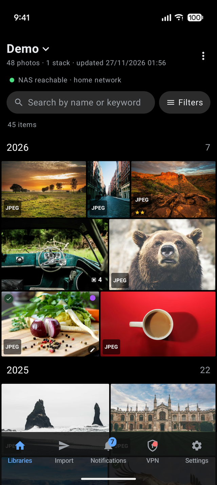
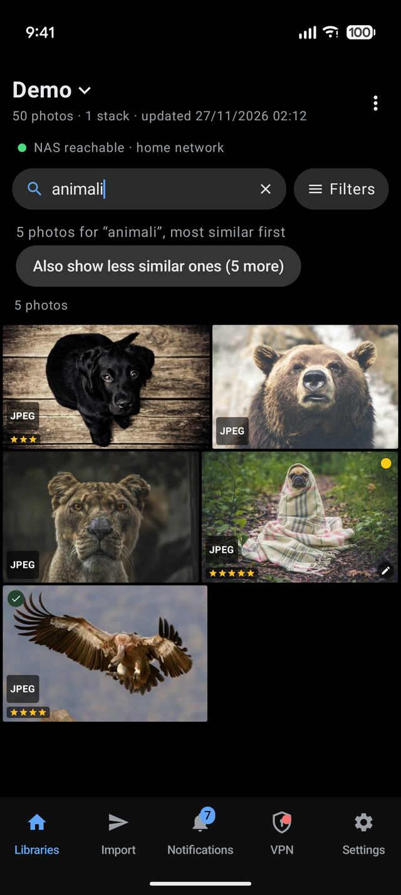
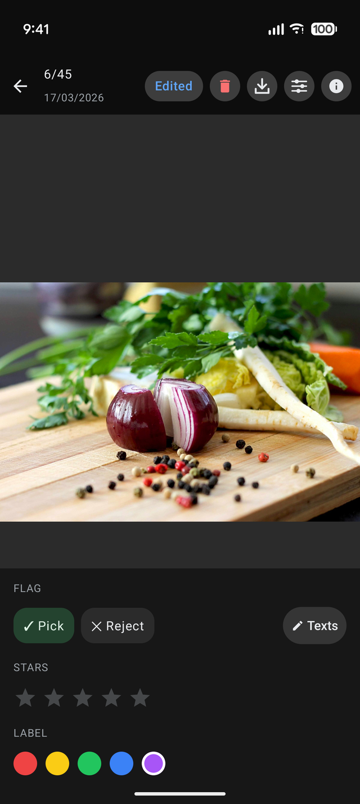
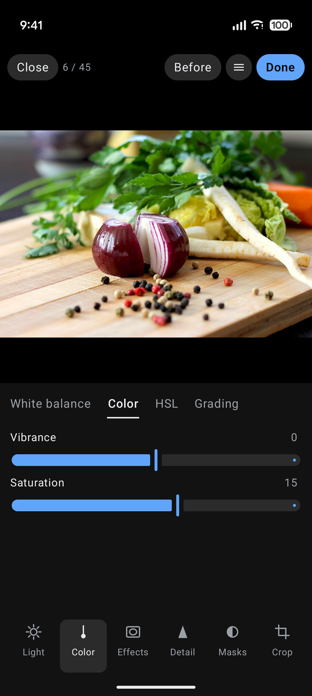
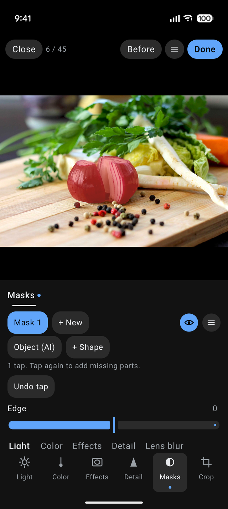
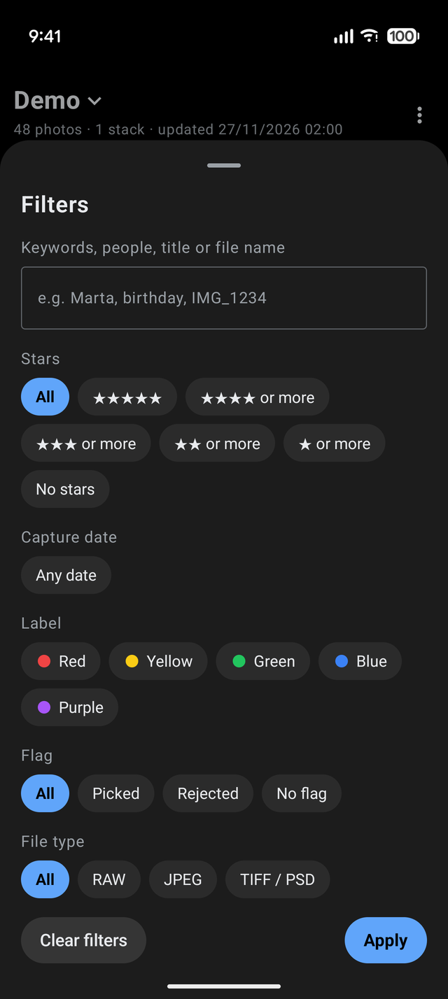

<h1 align="center">ViewerCraftStar</h1>

<p align="center">
Review the raw photos on your Android phone, rate and flag them, and send them home — to a Synology NAS and into
<b>LightCraft</b> — with all your choices.<br>
<a href="#-italiano">🇮🇹 Italiano</a> · <a href="https://github.com/poty87/ViewerCraftStar/releases/latest">⬇ Download</a> · <a href="https://buymeacoffee.com/poty87">☕ Buy me a coffee</a> · <a href="https://paypal.me/poty87">PayPal</a>
</p>

> ViewerCraftStar is an independent app. It is not made by, affiliated with or endorsed by the authors of
> [LightCraft](https://github.com/storytold/lightcraft), Ricoh or Synology.

> [!IMPORTANT]
> **At the moment it works only with Ricoh GR DNG files** (tested with the GR IV), on Android 13 or later. It is the
> phone side of [PresetCraftAppLicator](https://github.com/poty87/PresetCraftAppLicator), which runs on the home PC.

## Screenshots

<table>
<tr><td align="center"><br><sub>Library with periods, stacks, stars and flags</sub></td><td align="center"><br><sub>Search by subject (AI)</sub></td><td align="center"><br><sub>Flags, stars and labels</sub></td></tr>
<tr><td align="center"><br><sub>Develop with LightCraft's engine</sub></td><td align="center"><br><sub>AI object mask with one tap</sub></td><td align="center"><br><sub>Filters</sub></td></tr>
</table>

<sub>Screenshots taken on a demo library: free photos from [Unsplash](https://unsplash.com/license) (via Lorem Picsum) and Ricoh GR sample raws from [raw.pixls.us](https://raw.pixls.us/) (CC0).</sub>

## Part of a suite

This app is one of three independent tools that, together, build a **workflow for [LightCraft](https://github.com/storytold/lightcraft)
with your photos on a NAS**: shoot, review on the phone, send home, import with the right colours, and keep the NAS clean.
Each one works on its own; together they cover the whole path.

| App | Runs on | What it does |
|---|---|---|
| [**PresetCraftAppLicator**](https://github.com/poty87/PresetCraftAppLicator) | Windows PC | Gives LightCraft photos the camera profile of the style they were shot with. Watches a NAS folder and imports new photos automatically; applies the ratings, flags, metadata and presets chosen on the phone and tells the phone which photos are safe at home. |
| [**ViewerCraftStar**](https://github.com/poty87/ViewerCraftStar) | Android | Review the raw files on the phone (flags, stars, labels, metadata, LightCraft presets with preview), send them to the NAS through Synology Drive, follow them until they are safe on the NAS and in LightCraft, then free the phone. |
| [**CleanCraftNas**](https://github.com/poty87/CleanCraftNas) | Windows PC | Deletes from disk — even on the NAS — the photos you put in LightCraft's trash, so the NAS stays in step with the library. |

**The workflow**

1. Shoot, and let the raw files reach the phone (for example with the camera's own app).
2. **ViewerCraftStar**: review them, then *Send to the NAS* — Synology Drive uploads the photos and the app writes your
   choices next to them (`.xmp`).
3. **PresetCraftAppLicator** (home PC): imports them into LightCraft with the right camera profile and applies your choices.
4. Edit in LightCraft; the photos you don't want go to LightCraft's trash.
5. **CleanCraftNas**: deletes those photos from the NAS too.

**Away from home** the phone reaches the NAS through a VPN to your home network: see the
[remote access guide](https://github.com/poty87/ViewerCraftStar/blob/main/docs/remote-access.md) (Synology *VPN Server* with OpenVPN on the NAS, the VPN built into the app on the phone, port
forwarding through one or two routers).

## How it works

1. The raw files (DNG) arrive on the phone (for example from the camera's own app) in the app's **work folder**, which
   is *not* synced.
2. In **To review** you look at them full screen, swipe between them and set **flags** (pick / reject), **stars**,
   **colour labels**, title, caption, keywords, creator and copyright, and optionally a LightCraft **preset**, previewed
   on the phone.
3. **Send to the NAS** moves every photo to the folder that **Synology Drive** backs up to the NAS. **Rejected** photos
   are not sent: they go to the phone's bin (recoverable for 30 days).
4. As soon as each DNG is on the NAS, the app writes a small `.xmp` file next to it with your choices. On the home PC,
   PresetCraftAppLicator imports the photos into LightCraft with the right camera profile and applies ratings, flags,
   labels, metadata and preset.
5. The **Sent** section shows where each photo is:
   - 🔴 red — the photo or its metadata is not on the NAS yet (or was changed afterwards);
   - 🔵 blue — photo and metadata are safe on the NAS (they enter LightCraft when the home PC is on);
   - 🟢 green — already in LightCraft.

   Blue and green photos can be moved to the phone's bin with one tap.

After *Send to the NAS* the work goes on in the background, with a notification and a progress bar, even with the app
closed. It stops by itself when every photo is safe on the NAS with its metadata: the home PC brings them into
LightCraft when it is on.

## Straight from a RICOH GR camera

The round import button at the bottom left of **To review** opens a menu: **Camera** or **External disk**. Camera
downloads the photos straight from a RICOH GR (tested with
the GR IV), without the camera maker's app: the phone wakes the camera over Bluetooth, turns on its Wi-Fi, joins it and
shows the photos with thumbnails, grouped by day, month or year. Downloaded DNGs land in the work folder, ready in To
review; JPEGs go to the phone's gallery (`DCIM/Camera`). Files get the same names as with the camera maker's app
(capture time in milliseconds + the camera's file name), and photos already on the phone or the NAS are not downloaded
again. To pair a new camera, the app shows the steps (on the camera: Wireless Communication › Pairing › Execute
Pairing, then press OK twice while the QR code is shown). Plain http is allowed only towards the camera (192.168.0.1).

**External disk** imports from a USB stick, disk or card reader plugged into the phone, through Android's folder picker:
the first time it opens on the plugged-in disk (tap «Use this folder» and «Allow»), afterwards that disk opens directly.
The page works like the camera one (format, grouping, already-imported photos dimmed, copy in the background with the
same file names). Android reads FAT32 and exFAT disks, not NTFS.

## Library: your home LightCraft library on the phone

The **Library** tab shows your LightCraft libraries — all of them, not only the photos sent from the phone — from the
index that [PresetCraftAppLicator](https://github.com/poty87/PresetCraftAppLicator) (1.15.0 or later; 1.16.0 for search by subject) writes in a service
folder on the NAS (*Automatic import › Libraries to browse on the phone*; set the same folder in the app under
*Settings › Home library*). Photos and catalogs stay where they are.

- **Browse** by capture date, with LightCraft's **stacks** (cover and number of photos; tap the number to open or close).
- **Search by subject** (AI): write what is in the photo — *cats*, *vintage car*, *sunset at the beach*, *woman with a
  hat* — and get every matching photo, most similar first (also photos of the same stack; *Also show less similar ones*
  for more). It works for the libraries analyzed by PresetCraftAppLicator's optional AI engine (1.16.0 or later, model
  [MetaCLIP 2](https://github.com/facebookresearch/MetaCLIP), CC BY-NC 4.0: non-commercial use only). The first time the
  app downloads from the NAS the text part of the model (about 830 MB, once; *Settings* shows its size and deletes it);
  then search runs on the phone, even without the NAS, in about 2 seconds. Search starts with *Search* on the keyboard
  or after a short pause; *Names and keywords* searches the text instead. If the PC also wrote **descriptions** of the
  photos (PresetCraftAppLicator 1.17.0, optional), photos whose description contains the words searched for move up:
  more precise in the details (colours, objects, a car rather than a scooter). The description shows in the photo's
  details, and *Names and keywords* searches it too.
- **Filter**: the row has *Search*, *All filters* and *Stars*. *All filters* opens a panel with everything together —
  text or subject, stars, capture dates, colour labels, camera, flag, file type (RAW, JPEG, TIFF/PSD) — applied with
  *Apply*; the button turns blue with the number of filters set in it, *Clear all* removes them.
- **View** full screen with swipe and photo details. Previews are the JPEGs the camera embedded in the files (DNG, CR2,
  ORF, JPG), read from the NAS a piece at a time: they show the photo as shot, not with LightCraft's edits. DNGs saved
  by Lightroom whose preview is split into tiles, or that only have Lightroom's "fast load data", are put together and
  developed on the phone; TIFFs without a preview are read pixel by pixel. Thumbnails stay on the phone.
- **Edit** stars, flags, colour labels, title, caption and keywords, one photo at a time or many at once (long press to
  select). Changes show at once with an orange dot and are left on the NAS; PresetCraftAppLicator applies them to
  LightCraft (with LightCraft closed, after a backup) and the dot disappears when the new index confirms them.
- **Stack** selected photos (the first one selected is the cover; stacks they are already in are merged) or move them
  to **LightCraft's trash** (*Recently Deleted*). The phone never deletes files: they stay on the NAS until you check
  them in LightCraft or delete them with [CleanCraftNas](https://github.com/poty87/CleanCraftNas). Needs
  PresetCraftAppLicator 1.15.0 or later.
- **Download** selected photos to `Pictures/ViewerCraftStar Download`: the original file or the camera's JPEG, in the
  background with a notification.

The index is kept on the phone, so the library can be browsed (and edited — changes wait) even when the NAS can't be
reached.

## Away from home

The app talks to the NAS over SMB on your home network. Away from home it needs a VPN to your home network — for example
the free **VPN Server** package of Synology DSM with OpenVPN. The VPN is built into the app: the **shield in the bottom
bar** turns it on and off (red dot off, yellow connecting, green on), and while it's on an Android notification offers
"Turn off". The engine is the free **OpenVPN for Android** app (installed from the Play Store, never opened): the app
passes it the whole configuration at each start through its public API, so the password stays only in ViewerCraftStar,
encrypted. In **Settings › VPN** you import the zip exported by Synology VPN Server (also kept in the service folder and
in the settings backup), set the external server and port, user and password, and choose how it turns on: **manual**
(default), **when the app opens** away from home, or **fully automatic** (experimental: also turns off on the home
Wi-Fi, recognised by your NAS's identity, and pauses AdGuard). Android keeps one VPN at a time: if another one (such as
AdGuard) is on, the shield explains it and opens that app. The top of the screen always shows whether the NAS can be
reached (home network, via VPN, another VPN in the way, or not reachable).

Synology Drive uploads the photos on its own, with its own settings (for example only on Wi-Fi), wherever you are.

Step-by-step setup — DDNS, port forwarding through one or two routers, VPN Server, the `.ovpn` profile (including the fix
for file writes timing out on mobile data) and the phone: **[docs/remote-access.md](docs/remote-access.md)**.

## What you need

- An Android phone with Android 13 or later.
- A Synology NAS with **Synology Drive** backing up the phone's "sent" folder (Photo Backup), and an SMB share the app can
  write to.
- [PresetCraftAppLicator](https://github.com/poty87/PresetCraftAppLicator) with *automatic import* watching the same NAS
  folder, on the PC where your LightCraft library is.

## Install and set up

1. Download the `.apk` from the [latest release](https://github.com/poty87/ViewerCraftStar/releases/latest) and open it
   on the phone (Android asks to allow installing apps from your browser or file manager).
2. Open the app and allow access to photos (*Allow all*); notifications and nearby devices (for the camera) are asked
   together. Then turn on **media management** once in the Android page the app opens: sending and moving to the bin
   no longer ask for confirmation every time. **Settings › Permissions** shows them all and grants the missing ones.
3. In **Settings**:
   - **Work folder** (default `Pictures/VCS_Import_Photo/`, created if missing) and **folder synced with the NAS**
     (default `Pictures/VCS_Dng_Sync/`, the one Synology Drive backs up);
   - **NAS**: IP address, shared folder, folder inside the share, user and password — then *Test connection*;
   - default creator and copyright, and the sending notifications;
   - **Settings backup**: a zip in the service folder on the NAS (`backups/ViewerCraftStar`) with settings, photo
     metadata and pending library edits — never the NAS password — and *Restore…* to bring one back.
4. Point your camera app (or file manager rule) to put new DNG files in the work folder.

## Privacy

- The NAS password is stored on the phone encrypted with a key from the Android Keystore; it never leaves the phone
  except to log in to your NAS.
- On the NAS the app only writes `.xmp` files (and preset files you choose to import) in your photo folder: it never
  changes or deletes photos.
- No accounts, no analytics, no internet services: the app only talks to your NAS.

## Build from source

Android SDK (API 35) and JDK 17:

```
./gradlew assembleDebug        # app/build/outputs/apk/debug/
./gradlew assembleRelease      # signed only if keystore.properties exists
```

To sign a release, create a keystore and a `keystore.properties` file in the project folder (both are ignored by git):

```
storeFile=viewercraftstar.keystore
storePassword=…
keyAlias=viewercraftstar
keyPassword=…
```

## Support the project

ViewerCraftStar is free and will stay free: no subscriptions, no ads, no accounts. If it is useful to you and you would like to
help me spend more time on it, you can [buy me a coffee](https://buymeacoffee.com/poty87) or donate with [PayPal](https://paypal.me/poty87). Thank you! ☕

## Licence

MIT — see [LICENSE](LICENSE). Uses [smbj](https://github.com/hierynomus/smbj) (Apache 2.0), Jetpack Compose (Apache 2.0)
and [ONNX Runtime](https://github.com/microsoft/onnxruntime) (MIT) for search by subject. The files in
`app/src/main/aidl/de/blinkt/openvpn/api` and `app/src/main/java/de/blinkt/openvpn/api` are the public API of
[OpenVPN for Android](https://github.com/schwabe/ics-openvpn) by Arne Schwabe (Apache 2.0, exempted from that app's GPL);
OpenVPN for Android itself is a separate app, not included. The «Object (AI)» masks use Google's MagicTouch model
from [MediaPipe](https://github.com/google-ai-edge/mediapipe) (`app/src/main/assets/magic_touch.tflite`, Apache 2.0)
run with [LiteRT](https://github.com/google-ai-edge/LiteRT) (Apache 2.0).

---

## 🇮🇹 Italiano

ViewerCraftStar serve a rivedere sul telefono Android i raw appena scattati, dare stelle e bandierine e mandarli a casa —
sul NAS Synology e dentro **LightCraft** — con tutte le tue scelte. È la parte "telefono" di
[PresetCraftAppLicator](https://github.com/poty87/PresetCraftAppLicator), che gira sul PC di casa.

> [!IMPORTANT]
> **Per ora funziona solo con i DNG delle Ricoh GR** (provata con la GR IV), su Android 13 o successivo.

Le schermate sono [in cima alla pagina](#screenshots).

### Fa parte di una suite

Questa app è uno di tre programmi indipendenti che, insieme, creano un **flusso di lavoro per
[LightCraft](https://github.com/storytold/lightcraft) con le foto su un NAS**: scatti, rivedi sul telefono, spedisci a casa,
importi con i colori giusti e tieni pulito il NAS. Ognuno funziona anche da solo; insieme coprono tutto il percorso.

| App | Dove gira | A cosa serve |
|---|---|---|
| [**PresetCraftAppLicator**](https://github.com/poty87/PresetCraftAppLicator) | PC Windows | Dà alle foto di LightCraft il profilo della fotocamera dello stile con cui le hai scattate. Osserva una cartella del NAS e importa da solo le foto nuove; applica stelle, bandierine, metadati e preset scelti sul telefono e dice al telefono quali foto sono al sicuro a casa. |
| [**ViewerCraftStar**](https://github.com/poty87/ViewerCraftStar) | Android | Rivedi i raw sul telefono (bandierine, stelle, etichette, metadati, preset di LightCraft con anteprima), spediscili sul NAS tramite Synology Drive, seguili finché sono al sicuro sul NAS e in LightCraft, poi libera il telefono. |
| [**CleanCraftNas**](https://github.com/poty87/CleanCraftNas) | PC Windows | Cancella dal disco — anche dal NAS — le foto che hai messo nel cestino di LightCraft, così il NAS resta allineato alla libreria. |

**Il flusso di lavoro**

1. Scatti e fai arrivare i raw sul telefono (per esempio con l'app della fotocamera).
2. **ViewerCraftStar**: li rivedi e premi *Spedisci al NAS* — Synology Drive carica le foto e l'app scrive accanto a ognuna
   le tue scelte (`.xmp`).
3. **PresetCraftAppLicator** (PC di casa): le importa in LightCraft con il profilo giusto e applica le tue scelte.
4. Lavori in LightCraft; le foto che non vuoi finiscono nel cestino di LightCraft.
5. **CleanCraftNas**: cancella quelle foto anche dal NAS.

**Fuori casa** il telefono raggiunge il NAS con una VPN verso la rete di casa: vedi la
[guida all'accesso da fuori casa](https://github.com/poty87/ViewerCraftStar/blob/main/docs/remote-access.md#-italiano) (*VPN Server* di Synology con OpenVPN sul NAS, la VPN dentro l'app sul
telefono, inoltro della porta attraverso uno o due router).

**Come funziona**

1. I DNG arrivano sul telefono nella **cartella di lavoro** dell'app, che *non* è sincronizzata.
2. In **Da rivedere** le guardi a tutto schermo, scorri tra una e l'altra e imposti **bandierine** (scelta / scartata),
   **stelle**, **etichette colore**, titolo, didascalia, parole chiave, autore, copyright e, se vuoi, un **preset** di
   LightCraft, con l'anteprima sul telefono.
3. **Spedisci al NAS** sposta tutte le foto nella cartella che **Synology Drive** carica sul NAS. Le **scartate** non
   partono: vanno nel cestino del telefono (recuperabili per 30 giorni).
4. Appena ogni DNG è sul NAS l'app gli scrive accanto un piccolo `.xmp` con le tue scelte; sul PC di casa
   PresetCraftAppLicator importa le foto in LightCraft con il profilo giusto e applica stelle, bandierine, etichette,
   metadati e preset.
5. La sezione **Inviate** mostra dove si trova ogni foto: 🔴 rossa = foto o metadati non ancora sul NAS (o cambiati dopo),
   🔵 blu = foto e metadati al sicuro sul NAS (entrano in LightCraft quando il PC di casa è acceso), 🟢 verde = già in
   LightCraft. Blu e verdi si tolgono dal telefono con un tocco.

Dopo *Spedisci al NAS* il lavoro continua in background, con una notifica e una barra di avanzamento, anche con l'app
chiusa, e si ferma da solo quando tutte le foto sono al sicuro sul NAS con i metadati: in LightCraft le porta il PC di
casa quando è acceso.

**Direttamente dalla fotocamera RICOH GR o da un disco esterno.** Il pulsante tondo di importazione in basso a sinistra in
**Da rivedere** apre un menu: **Fotocamera** o **Disco esterno**. Fotocamera scarica le foto direttamente da una RICOH GR (provata con la GR IV), senza l'app del produttore: il telefono sveglia la
fotocamera via Bluetooth, ne accende il Wi-Fi, ci si collega e mostra le foto con le miniature, per giorno, mese o anno.
I DNG scaricati vanno nella cartella di lavoro, pronti in Da rivedere; i JPEG nella galleria del telefono
(`DCIM/Camera`). I file hanno gli stessi nomi dell'app del produttore (ora di scatto in millisecondi + il nome del file
della fotocamera) e le foto già sul telefono o sul NAS non si riscaricano. Per associare una fotocamera nuova l'app
mostra i passaggi (sulla fotocamera: Wireless Communication › Pairing › Execute Pairing, poi OK due volte mentre è
visibile il QR). L'http non cifrato è permesso solo verso la fotocamera (192.168.0.1). **Disco esterno** importa da una
chiavetta, un disco o un lettore di schede collegato al telefono, tramite il selettore di cartelle di Android: la prima
volta si apre sul disco collegato («Usa questa cartella» e «Consenti»), dopo quel disco si apre da solo. La pagina è come
quella della fotocamera (formato, raggruppamento, foto già importate scure, copia in background con gli stessi nomi).
Android legge i dischi FAT32 ed exFAT, non NTFS.

**Libreria: la libreria LightCraft di casa sul telefono.** La scheda **Libreria** mostra le tue librerie LightCraft — tutte,
non solo le foto spedite dal telefono — dall'indice che PresetCraftAppLicator (1.15.0 o successivo) scrive in una cartella
di servizio sul NAS (*Importazione automatica › Librerie da consultare sul telefono*; nell'app la stessa cartella in
*Impostazioni › Libreria di casa*). Foto e cataloghi restano dove sono.
- **Sfoglia** per data di scatto, con le **pile** di LightCraft (copertina e numero di foto; tocca il numero per aprirle o
  chiuderle).
- **Cerca per soggetto** (IA): scrivi cosa c'è nella foto — *gatti*, *auto d'epoca*, *tramonto al mare*, *donna con il
  cappello* — e trovi tutte le foto che corrispondono, dalla più somigliante (anche quelle della stessa pila; *Mostra
  anche le meno somiglianti* per averne di più). Funziona con le librerie analizzate dal motore IA facoltativo di
  PresetCraftAppLicator (1.16.0 o successivo, modello [MetaCLIP 2](https://github.com/facebookresearch/MetaCLIP), CC BY-NC
  4.0: solo uso non commerciale). La prima volta l'app scarica dal NAS la parte "testo" del modello (circa 830 MB, una volta
  sola; in *Impostazioni* vedi quanto occupa e lo elimini); poi la ricerca gira sul telefono, anche senza NAS, in circa 2
  secondi. Parte con *Cerca* sulla tastiera o dopo una breve pausa; *Nomi e parole chiave* cerca invece nel testo. Se il
  PC ha scritto anche le **descrizioni** delle foto (PresetCraftAppLicator 1.17.0, facoltative), salgono le foto la cui
  descrizione contiene le parole cercate: più precisione nei dettagli (colori, oggetti, un'auto e non una Vespa). La
  descrizione si vede nei dettagli della foto, e *Nomi e parole chiave* cerca anche lì.
- **Filtra**: nella riga ci sono *Cerca*, *Tutti i filtri* e *Stelle*. *Tutti i filtri* apre un pannello con tutto insieme
  — testo o soggetto, stelle, date di scatto, etichette colore, fotocamera, bandierina, tipo di file (RAW, JPEG, TIFF/PSD)
  — che si applica con *Applica*; il pulsante diventa blu con il numero dei filtri impostati lì, *Azzera tutto* li toglie.
- **Guarda** a tutto schermo con lo scorrimento e i dettagli della foto. Le anteprime sono i JPEG che la fotocamera ha
  messo nei file (DNG, CR2, ORF, JPG), letti dal NAS a pezzi: mostrano la foto come scattata, non con le modifiche di
  LightCraft. I DNG salvati da Lightroom con l'anteprima divisa in tasselli, o con solo i "fast load data" di Lightroom,
  vengono ricomposti e sviluppati sul telefono; i TIF senza anteprima si leggono pixel per pixel. Le miniature restano sul
  telefono.
- **Modifica** stelle, bandierine, etichette, titolo, didascalia e parole chiave, di una foto o di molte insieme (pressione
  lunga per selezionare). Le modifiche si vedono subito con un pallino arancione e vengono lasciate sul NAS;
  PresetCraftAppLicator le applica a LightCraft (con LightCraft chiuso, dopo un backup) e il pallino sparisce quando il
  nuovo indice le conferma.
- **Raggruppa in una pila** le foto selezionate (la prima selezionata è la copertina; le pile in cui sono già vengono
  unite) o spostale nel **cestino di LightCraft** (*Eliminate di recente*). Il telefono non cancella mai i file: restano sul
  NAS finché non li ricontrolli in LightCraft o li cancelli con [CleanCraftNas](https://github.com/poty87/CleanCraftNas).
  Serve PresetCraftAppLicator 1.15.0 o successivo.
- **Scarica** le foto selezionate in `Pictures/ViewerCraftStar Download`: l'originale o il JPEG della fotocamera, in
  background con una notifica.

L'indice resta sul telefono: la libreria si sfoglia (e si modifica — le modifiche aspettano) anche senza NAS.

**Fuori casa** serve una VPN verso la rete di casa, per esempio il pacchetto gratuito **VPN Server** di Synology con
OpenVPN. La VPN è dentro l'app: lo **scudo nella barra in basso** la accende e la spegne (pallino rosso spenta, giallo
in collegamento, verde accesa) e, mentre è accesa, una notifica di Android offre «Spegni». Il motore è l'app gratuita
**OpenVPN for Android** (dal Play Store, mai da aprire): a ogni accensione l'app le passa la configurazione completa con
la sua API pubblica, quindi la password resta solo in ViewerCraftStar, cifrata. In **Impostazioni › VPN** importi lo
zip esportato da Synology VPN Server (tenuto anche nella cartella di servizio e nel backup), imposti server e porta
esterni, utente e password, e scegli come si accende: **manuale** (di partenza), **all'avvio dell'app** fuori casa, o
**completamente automatica** (sperimentale: si spegne anche sul Wi-Fi di casa, riconosciuto dall'identità del NAS, e
mette in pausa AdGuard). Android tiene una VPN alla volta: se ce n'è un'altra accesa (come AdGuard) lo scudo lo spiega e
apre quell'app. In alto l'app mostra sempre se il NAS è raggiungibile (rete di casa, via VPN, un'altra VPN in mezzo, non
raggiungibile). Synology Drive carica le foto per conto suo, con le sue impostazioni, ovunque tu sia.
La configurazione passo per passo — DDNS, inoltro della porta attraverso uno o due router, VPN Server, il profilo `.ovpn`
(compresa la correzione per le scritture che vanno in timeout sui dati mobili) e il telefono — è nella
**[guida all'accesso da fuori casa](docs/remote-access.md#-italiano)**.

**Cosa serve**: un telefono Android 13 o successivo; un NAS Synology con **Synology Drive** che fa il backup della cartella
"spedite" del telefono e una cartella condivisa SMB in cui l'app può scrivere; PresetCraftAppLicator con l'*importazione
automatica* sulla stessa cartella del NAS, sul PC con la libreria LightCraft.

**Installazione e impostazioni**

1. Scarica l'`.apk` dall'[ultima release](https://github.com/poty87/ViewerCraftStar/releases/latest) e aprilo sul telefono
   (Android chiede di consentire l'installazione di app dal browser o dal gestore file).
2. Apri l'app e consenti l'accesso alle foto (*Consenti tutto*); insieme chiede notifiche e dispositivi nelle vicinanze
   (per la fotocamera). Poi attiva una volta la **gestione dei media** nella pagina di Android che l'app apre: spedire e
   spostare nel cestino non chiedono più conferma ogni volta. **Impostazioni › Permessi** li mostra tutti e concede
   quelli che mancano.
3. Nelle **Impostazioni**: cartella di lavoro (predefinita `Pictures/VCS_Import_Photo/`, creata se manca) e cartella
   sincronizzata con il NAS (predefinita `Pictures/VCS_Dng_Sync/`); dati del NAS (IP, cartella condivisa, cartella
   interna, utente e password) e *Prova connessione*; autore e copyright predefiniti; notifiche della spedizione;
   **backup delle impostazioni**: uno zip nella cartella di servizio sul NAS (`backups/ViewerCraftStar`) con
   impostazioni, metadati delle foto e modifiche alle librerie in attesa — mai la password del NAS — e *Ripristina…*
   per riprenderne uno.
4. Fai arrivare i DNG nuovi nella cartella di lavoro (app della fotocamera o regola di un gestore file).

**Privacy**: la password del NAS resta sul telefono, cifrata con una chiave del Keystore di Android; sul NAS l'app scrive
solo file `.xmp` (e i preset che scegli di importare) e non modifica né cancella mai le foto; niente account, statistiche o
servizi su internet: l'app parla solo con il tuo NAS.

**Licenza**: MIT — vedi [LICENSE](LICENSE). I file in `de/blinkt/openvpn/api` sono l'API pubblica di
[OpenVPN for Android](https://github.com/schwabe/ics-openvpn) di Arne Schwabe (Apache 2.0); l'app OpenVPN for Android
è separata e non inclusa. Le maschere «Oggetto (IA)» usano il modello MagicTouch di Google da
[MediaPipe](https://github.com/google-ai-edge/mediapipe) (`app/src/main/assets/magic_touch.tflite`, Apache 2.0), eseguito
con [LiteRT](https://github.com/google-ai-edge/LiteRT) (Apache 2.0).

### Sostieni il progetto

ViewerCraftStar è gratuita e lo resterà: niente abbonamenti, pubblicità o account. Se ti è utile e vuoi aiutarmi a dedicarci
più tempo, puoi [offrirmi un caffè](https://buymeacoffee.com/poty87) o fare una donazione con [PayPal](https://paypal.me/poty87). Grazie! ☕
